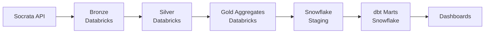

# NYC 311 Data Platform

End-to-end, production-grade data platform for NYC 311 Service Requests — spanning **Databricks**, **Snowflake**, **dbt**, and **Airflow**.

## Overview

- **Ingestion:** NYC 311 data pulled from the Socrata API into a Databricks Bronze Delta table
- **Transformation:** PySpark cleans and enriches into Silver and Gold aggregates
- **Warehouse:** Gold aggregates land in Snowflake for fast BI serving
- **Semantic Layer:** dbt defines business metrics and marts on top of Snowflake
- **Orchestration:** Airflow coordinates Databricks Jobs + Snowflake + dbt end-to-end
- **Governance:** Unity Catalog (Databricks) + Snowflake role-based access

## Architecture

## Tech Stack

- **Databricks** — lakehouse platform, Delta Lake, Unity Catalog
- **PySpark** — distributed data processing
- **Snowflake** — cloud warehouse for BI serving
- **dbt** — semantic layer and business marts
- **Airflow** — cross-platform orchestration

## Dataset

[NYC 311 Service Requests](https://data.cityofnewyork.us/Social-Services/311-Service-Requests-from-2010-to-Present/erm2-nwe9) — public complaints data from NYC Open Data.

**Current scope:** January 2025 (~348k complaints). The pipeline is parameterized — any date range can be ingested with a one-line change.

## Project Structure

(To be filled in as we build)

## Status

🚧 Project in progress — Bronze ingestion complete

### Completed
- ✅ Databricks catalog, schemas (`bronze`/`silver`/`gold`), and Volume created
- ✅ Bronze Delta table `nyc_311.bronze.raw_complaints` created (348,180 rows, 49 columns)
- ✅ Ingested from Socrata API with pagination and metadata tracking

### Next Steps
- 🔜 Silver transformation — clean, deduplicate, enrich
- 🔜 Gold aggregation — business-level summaries
- 🔜 Snowflake integration + dbt marts
- 🔜 Airflow orchestration

